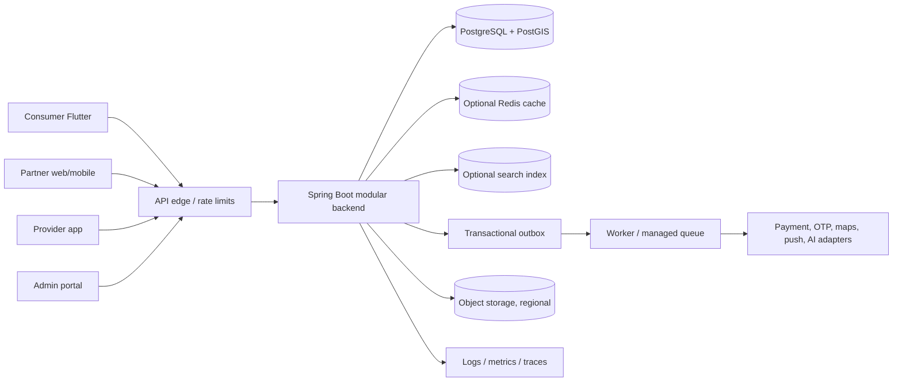

# 01 — Architecture Overview

## Recommendation

Use a **modular monolith for the transactional core**, with clean module APIs and independently scalable external adapters/jobs. Deploy the first release as one backend application and one PostgreSQL cluster in a Kazakhstan region whose location/capabilities are contractually verified. Flutter consumer app uses REST over HTTPS. Add async processing through transactional outbox plus a managed queue only where delivery/retry requires it. Search, analytics, AI inference and notifications are replaceable adapters, not authorities for core transaction state.

## Deployment and trust boundary

Clients are untrusted. Edge validates transport, request size, rate and token format; application performs authentication, tenant/resource authorization, domain validation and audit. PostgreSQL is source of truth for catalog publication, orders, bookings, payment references, permissions and audit metadata. External systems provide facts about their own transaction; verified callbacks/status queries are reconciled into internal records. AI output is always untrusted input.

## Transaction and async split

Keep in one DB transaction: state change plus corresponding outbox event; within each aggregate maintain invariants and ledger references. Use synchronous REST for interactive reads, quote/availability validation and commands needing immediate result. Use async workers for notification delivery, provider webhooks, reconciliation, search-index projection, analytics export, retries and long-running AI task steps. Never require eventual search/analytics consistency to authorize checkout.

## Growth path

One city/country first. Add read replicas/caches only after measured database pressure; partition high-volume append-only tables only after measured growth. Extract a module to a service only with clear data ownership, failure budget, team ownership or independent scaling/deployment benefit. Initial candidates: notification delivery, search projection, AI orchestration, payment adapter/reconciliation, dispatch. See 29.

## Consequences

Lower operational cost and simpler transaction integrity now; modules share process/database failure domains and need strict internal boundaries. The design deliberately accepts that tradeoff and makes extracted-service APIs/event contracts explicit before extraction.
