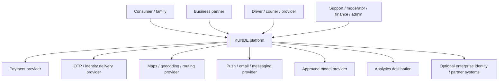

# 03 — System Context

## External actors and responsibilities

- Consumers create requests and authorize actions; family roles are scoped and explicit.
- Partners own their catalog accuracy and fulfillment decisions under marketplace terms.
- Providers fulfill assigned jobs; only assignment-required information is exposed.
- KUNDE owns platform identity links, listing eligibility, transaction coordination, support, audit, policy and customer-visible status.
- Payment provider owns its authorization/capture/refund rails; KUNDE owns order/payment linkage, internal journal and reconciliation workflow.
- OTP, maps, messaging, model and analytics providers are optional external processors. Their availability, data region, retention and contractual controls must be verified.

## Trust boundaries

1. Mobile/web clients → public API edge.
2. Public API → authenticated domain modules.
3. Domain modules → restricted PII/financial stores.
4. KUNDE → external processors and partner callbacks.
5. Privileged operations → support/finance/admin console.
6. AI orchestration → narrow tool gateway → domain command/query API.

Every crossing authenticates the caller, validates schema and scope, applies rate/abuse controls, records correlation and minimizes payload. See diagram `diagrams/01-system-context.md` and security 18.
