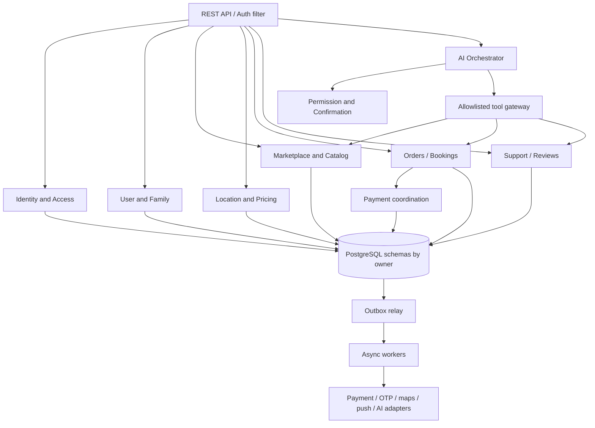

# 06 — Backend Architecture

## Runtime shape

One Spring Boot deployable, one relational source-of-truth cluster, explicit internal module contracts, and separate worker process/profile from the same codebase when load isolation is required. The worker may be deployed independently without making every domain a network service.

## Module rules

- Each module exposes application-service interfaces and DTOs; internal entities remain private.
- Modules may use same physical PostgreSQL database but separate schema/table ownership. Database constraints may reference same-owner entities; cross-owner foreign keys are discouraged and must not enable table-level coupling.
- Cross-module synchronous queries use interface methods, not cross-module repository calls. Cross-module updates use commands and domain events.
- Avoid distributed transaction assumptions. For multi-aggregate workflow, use orchestrator/saga state, outbox and compensating action.
- Modules must not import web/controller types from another module. Dependency direction is API adapter → application service → domain; infrastructure adapters implement ports.
- CI should validate dependency rules and migration ownership.

## Transaction boundaries and failure behavior

One request transaction may persist an aggregate change and outbox event. External network calls do not occur while holding DB locks. Payment/order/booking workflows persist intent, invoke provider asynchronously or via bounded call, verify callback/query, then update with optimistic version. Retryable tasks carry idempotency/correlation IDs and bounded attempts. Manual corrections are audited compensations.

## Data owners and scaling

See `07-domain-boundaries.md`. Stateless API replicas scale horizontally; DB connection pool is bounded. Workers have separate concurrency limits by queue/task class. Search and notification lag are acceptable; payment/order status is not derived from their projections. Read replicas are optional and not used for consistency-critical reads immediately after write.
