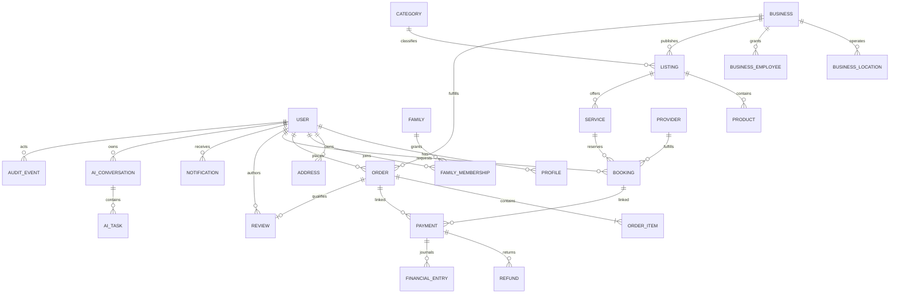

# 12 — Core Data Model

The ER view is logical, not final DDL. Modules own separate schemas and invariants. Personal-data storage location must be validated against Kazakhstan rules before selecting managed services.

## Entity responsibilities and keys

| Entity | Owner/schema | Key links and constraints |
|---|---|---|
| User, Profile, Session, Device, RoleGrant | IAM/User | UUID PK; normalized identity uniqueness policy; role grants scoped to tenant/resource and expiry |
| Family, Membership, Consent | User | family/user unique membership; actor and beneficiary distinguished; consent version/time/purpose |
| Address | User/Geo | owner + region reference; precise coordinates protected; validated service-area snapshot when used |
| Business, BusinessLocation, EmployeeGrant | Partner | business/location composite scope; verification status; employee role/purpose |
| Provider | Provider | user/business link, verification and eligibility; no cross-tenant task access |
| Category, Listing, Product, Service | Catalog | versioned listing; separate product/service tables; price model and localized fields; stock/availability not embedded as unbounded JSON |
| Quote, PromotionRedemption | Pricing | quote immutable snapshot with expiry, policy and currency; redemption idempotent and eligibility scoped |
| Order, OrderItem, FulfillmentTask | Order/Delivery | customer/partner refs, state/version; item and quote snapshots; unique idempotency scope |
| Booking, SlotHold, Resource | Booking | resource/slot/time zone and hold expiry; unique/exclusion rule prevents overlap; actor vs beneficiary |
| PaymentAttempt, Refund, FinancialEntry, Settlement | Finance | provider refs unique/deduped; immutable signed amount entries; currency and external correlation |
| Review, Notification, SupportCase | Trust/Messaging/Support | review eligibility reference; notification event dedupe key; case tenant/assignment scope |
| AIConversation, AITask, AITaskStep, Confirmation | AI | owner, retention/consent, draft version, tool/result metadata; no payment credential or unrestricted transcript by default |
| OutboxEvent, AuditEvent | Platform/security owners | append-only ID, schema version, aggregate ref, occurred time, actor/correlation; redacted payload |

## Index and deletion policy

IDs are primary keys; unique constraints enforce verified identity, provider event IDs, idempotency scope, review eligibility, active family membership and inventory/resource constraints. Composite indexes follow query plans listed in 11. Keep transaction and financial references immutable. Soft delete only for entities where restore/business semantics require it; deletion requests trigger field-level purge/pseudonymization schedule while preserving legally required transaction/audit evidence under restricted access. Exact retention and children/health handling require counsel.

Detailed storage types, nullability, partitioning and FK strategy are implementation design deliverables after vendor/volume assumptions are confirmed.
