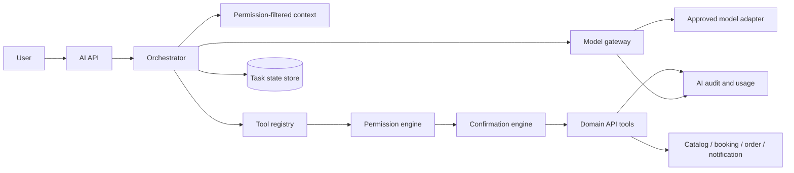

# 17 — AI Platform Architecture

## Components

1. **AI API** authenticates user and creates conversation/task IDs.
2. **Orchestrator** selects bounded task workflow; it does not grant permissions.
3. **Model gateway** abstracts providers, model classes, token/cost/time limits and region policy.
4. **Context service** retrieves minimum user-authorized preferences and conversation state.
5. **Tool registry** exposes typed, versioned query/command contracts with strict schemas and allowlist.
6. **Policy/permission engine** checks user, beneficiary, resource, purpose and role at planning and execution.
7. **Confirmation engine** binds explicit consent to exact draft/version/price/scope/expiry.
8. **Task runtime** persists step state, retries only idempotent operations, compensates/reports partial completion.
9. **Audit/evaluation** captures tool decisions/outcomes, latency, token and cost metadata with content minimization.

## Tool tiers

- Read: search catalog, compare availability, explain own transaction. Read permission per returned record; redact disallowed fields.
- Prepare: create ephemeral cart/quote/slot hold or proposed itinerary; no final commitment.
- Execute: booking/order/cancellation/reminder command only after confirmation appropriate to impact; domain API revalidates all rules.
- Forbidden: direct database access, raw payment provider calls, ledger mutation, access-grant management, arbitrary HTTP/code execution, hidden cross-user search.

## Partial completion and the requested scenario

For “find dentist tomorrow after 17:00, order taxi there, remind me”: (1) clarify city/time zone and permission to use selected location/calendar if missing; (2) query health directory and available slots; (3) present sourced candidates and any regulatory verification uncertainty; (4) obtain separate booking confirmation and execute via Booking API; (5) prepare taxi with pickup/destination/time/fare estimate, then obtain separate paid-transport confirmation; (6) create reminder only after user permits notification/time; (7) track each task step and report independent statuses. If appointment fails, do not book taxi. If taxi fails after appointment succeeds, keep appointment and offer retry/cancel option. If reminder fails, disclose it and preserve booking. Cross-step compensation is explicit, never silent.

## Safety and operations

Prompt injection in listing/review/user text is treated as data, not instruction. Model has no secrets; tool input is schema validated; output is escaped. Per-user and global budgets, deadline, max tool steps, circuit breaker and model fallback apply. Never fallback to a model/provider outside region/privacy policy. Delete conversation context independently from transaction/audit retention. AI response claims come from tool results and distinguish estimate from confirmed result. See PRD 1.1 §16.
