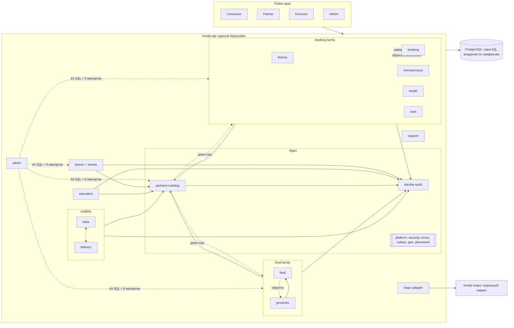

# Domain Components (фактическое состояние, C4 level 3)

В отличие от диаграмм 01–13 (целевое состояние) эта диаграмма показывает **реальные** зависимости на 2026-11-24 между модулями `:app` — по данным [матрицы зависимостей](../domain-dependency-matrix.md). Стрелка — «зависит от» (импорт или SQL в таблицы владельца). Контекст и контейнеры — [01](01-system-context.md), [02](02-container-architecture.md).

Пунктир — зависимости, которые мешают выделению (см. узел циклов в матрице).
