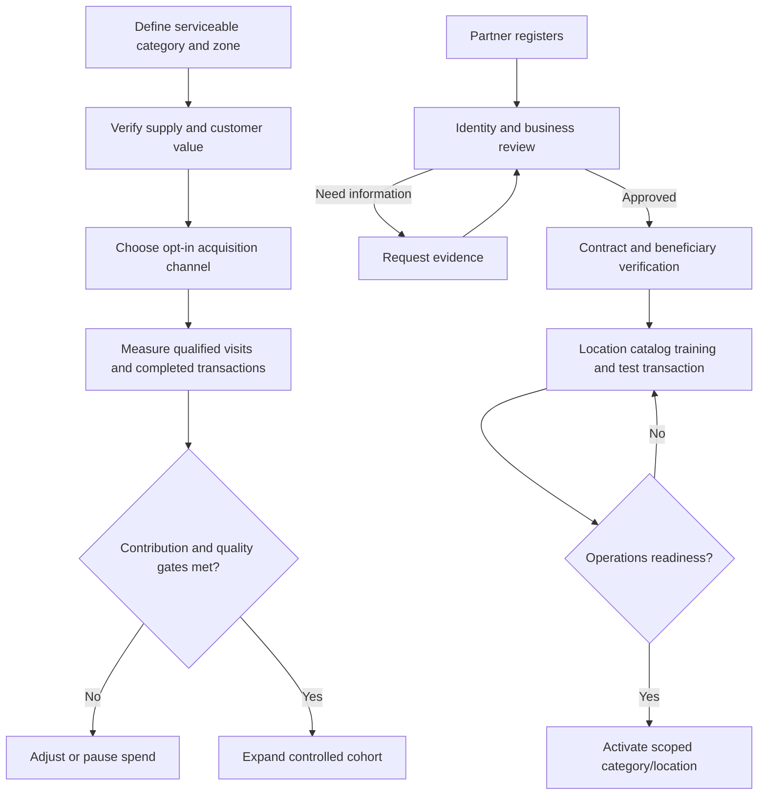
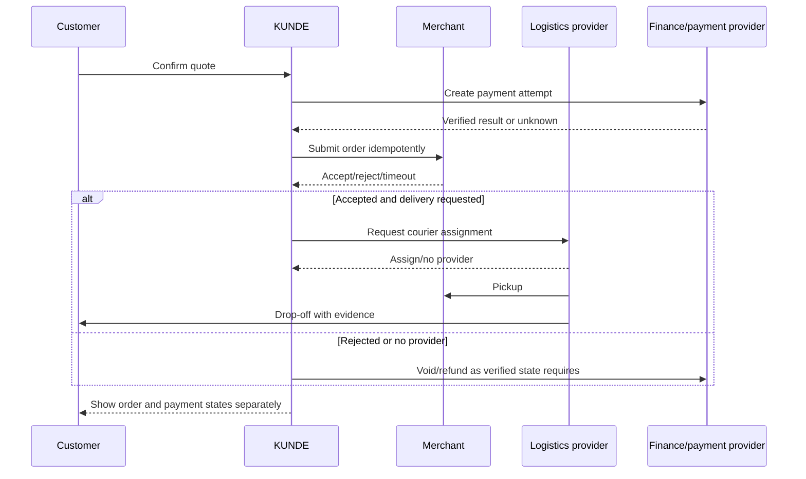
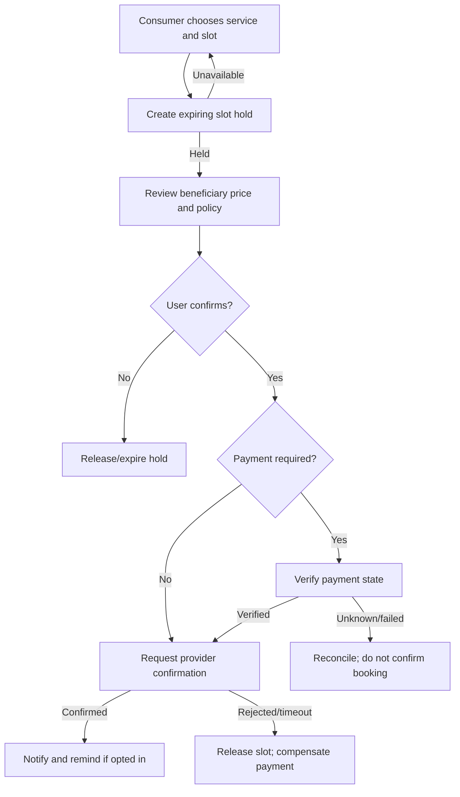
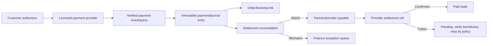
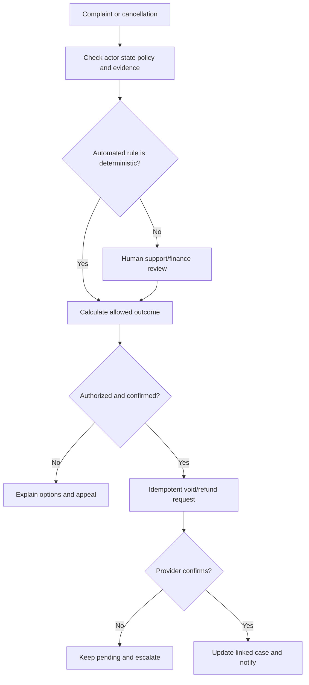
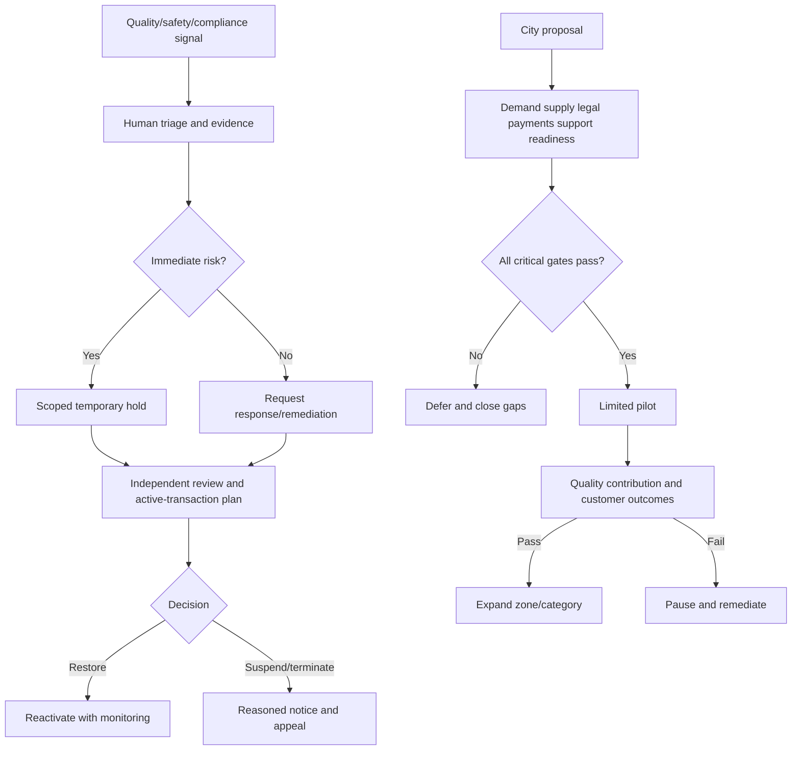
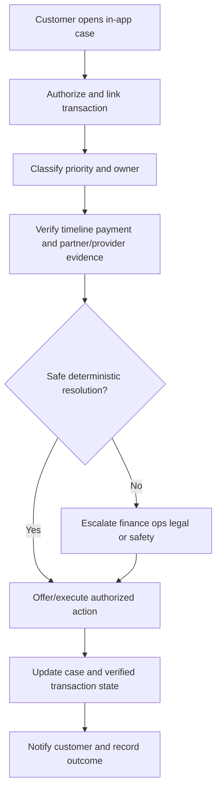

# 25 — Business Process Diagrams

Diagrams are target processes; category/legal/provider rules can add branches. `Pending` is not successful completion. Payment and business records remain separate (PRD/Architecture).

## Customer acquisition and partner onboarding

## Order fulfillment and delivery

## Booking fulfillment

## Payment, settlement and provider payout

## Refund, dispute and support

## Suspension and city launch

## Customer support

