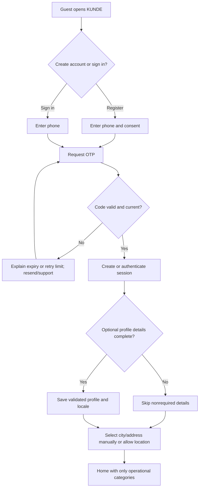
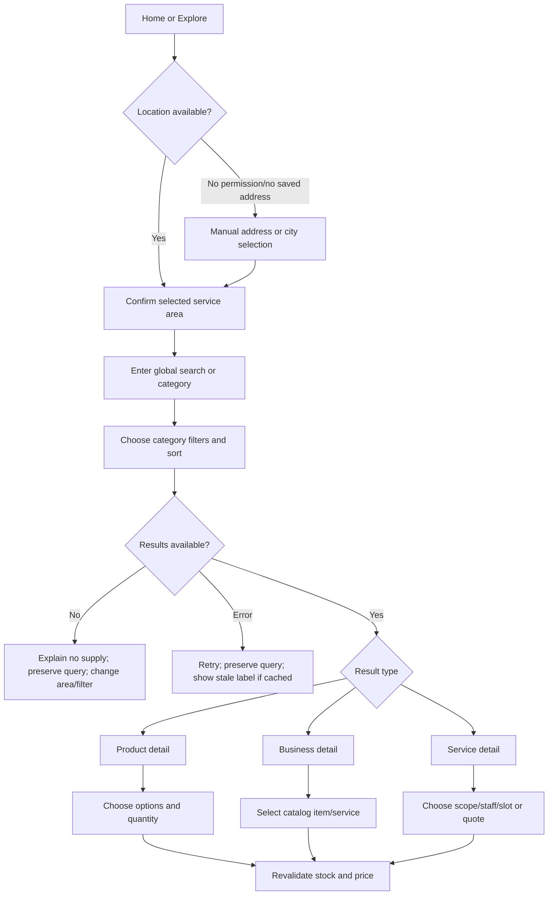
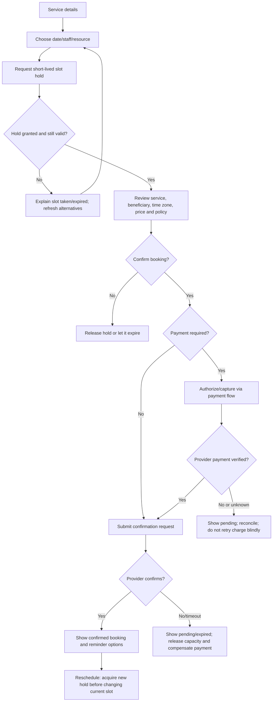
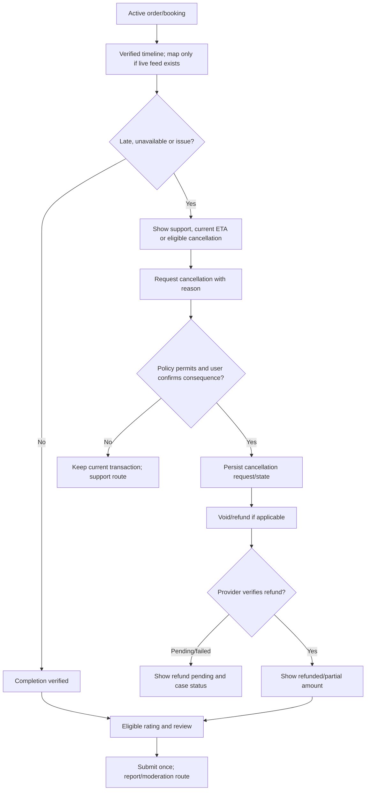
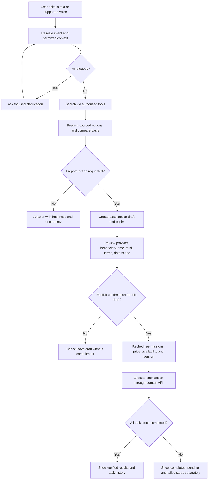

# 12 — User Flows

The flows reflect PRD 1.1 and architecture: state is server-authoritative, mutations are idempotent, payment confirmation is verified, and AI confirmation is specific to a draft. “Continue” never means success until the result is confirmed.

## Registration, login, OTP and onboarding



No phone-account enumeration before verification. OTP cooldown and session expiry use states in doc 14. Onboarding can be skipped except required consent/security steps.

## Address, global search, category, business and product



If map is unavailable, retain list/manual address. Stale search result cannot commit a transaction.

## Booking and rescheduling



## Food order, taxi request, payment and tracking

```mermaid
sequenceDiagram
 participant U as User
 participant K as KUNDE
 participant M as Merchant/dispatch
 participant P as Payment provider
 U->>K: Build merchant cart / mobility request
 K->>M: Validate inventory or route estimate
 M-->>K: Current availability and quote
 K-->>U: Show itemized total, terms and expiry
 U->>K: Confirm exact request with idempotency key
 K->>P: Initiate payment when required
 P-->>K: Verified event or unknown result
 K->>K: Persist linked payment and order/task state
 K->>M: Submit fulfillment/dispatch request
 M-->>K: Accept, reject, assign or timeout
 K-->>U: Show confirmed state or recovery/refund pending
 U->>K: Track timeline; request support/cancel if eligible
```

Food uses merchant-specific cart and preparation/delivery states. Taxi uses pickup/destination, fare-estimate expiry and provider assignment; no restaurant cart. If provider rejects or cannot be found, show cancellation and verified payment-compensation status.

## Delivery, cancel, refund, rating



## AI search, comparison, booking and multi-step action



Dentist + taxi + reminder is three dependent steps: appointment options first; book only after its confirmation; prepare taxi with a separate confirmation; schedule reminder only when opted in. If booking fails, do not schedule taxi. If taxi or reminder fails after booking succeeds, preserve the booking and explain the partial result.

## Flow coverage index

| Requested flow | Diagram/section |
|---|---|
| Registration, login, OTP, onboarding | Identity flow |
| Address selection, global search, category discovery, business/product selection | Discovery flow |
| Service booking, AI-assisted booking | Booking flow + AI flow |
| Food order, taxi order, payment, delivery tracking | Transaction sequence + delivery flow |
| Cancellation, refund, rating | Delivery flow |
| AI search, comparison, multi-step task | AI flow |

Every branch must preserve entered safe data, explain user options and emit auditable status. Payment/confirmation failures follow PRD 1.1 docs 09–17.
