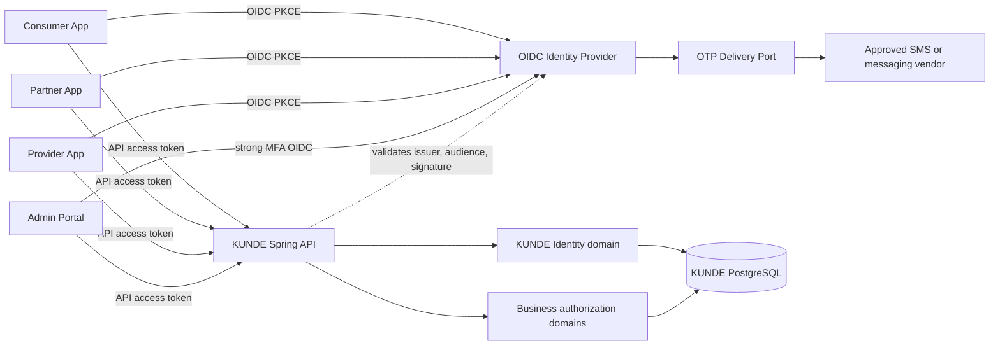

# System context

Dashed relation is metadata/JWKS trust and validation, not user authentication bypass. The diagram omits databases owned by an eventual IdP deployment because deployment model is undecided.
