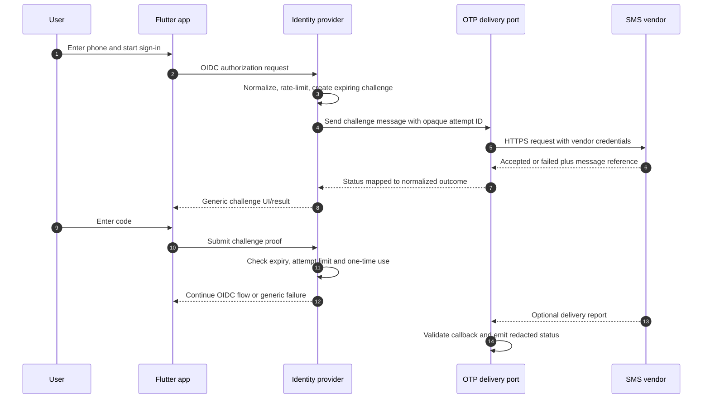

# OTP delivery sequence

Delivery status is not authentication proof. If the provider's API generates and verifies its own OTP, this sequence requires a supported IdP extension and a separate lock-in review.
