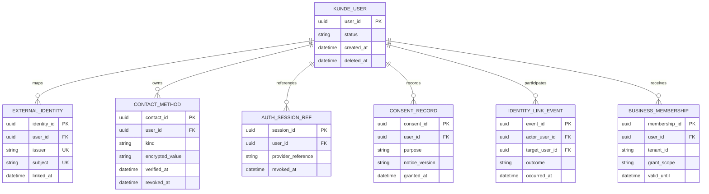

# Logical identity data model

Logical fields only; no migration or exact SQL type/uniqueness policy is approved. Enforce exact unique `(issuer, subject)`; contact uniqueness awaits shared/recycled-number policy.
