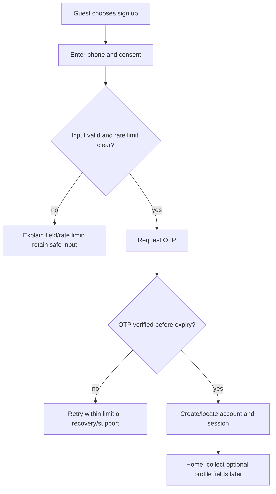
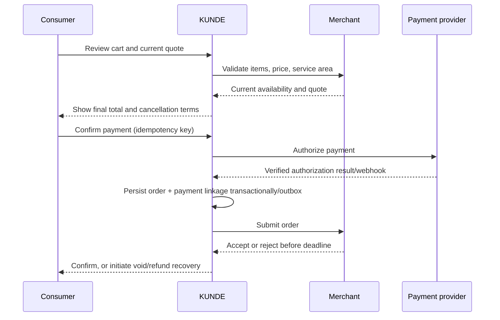

# 04 — User Flows

Flows describe externally observable behavior. Every mutation uses an authenticated, authorized, idempotent command where applicable. A retry must return or reveal the existing result, not create a second transaction.

## F-01 Registration and session

Never reveal whether an arbitrary phone belongs to an account before verification. OTP resend is throttled; old OTPs become invalid when superseded. A session expiry preserves a safe draft but requires re-authentication before a consequential action.

## F-02 Search and discovery

1. Resolve current location from a saved address, permitted device location, or explicit manual selection.
2. User enters query or selects category. Search receives locale, location, filters and cursor; sensitive profile data is excluded.
3. Return only active, eligible listings with availability/price freshness metadata. Separate category sections or explicit category scope prevent irrelevant cross-category mixing.
4. User opens listing; detail view shows provider, fulfillment area, total/price model, availability, cancellation terms and last-updated state.
5. If location is denied, ask for manual address. If no results, offer nearby category alternatives without implying availability. If query fails, preserve query and retry.

## F-03 Order (food / shopping)

If payment status is unknown, show “checking payment” and query/reconcile by provider reference; never ask user to pay again until duplicate risk is resolved. If payment succeeds but order persistence/submission fails, create a recovery case and void authorization or refund captured funds according to verified provider state. Merchant rejection triggers cancellation and refund/void path. User can cancel only while policy and current state permit; show consequences before committing.

## F-04 Appointment booking

User selects service, optional staff/resource, location and slot. KUNDE obtains a short-lived slot hold; the hold is not a confirmed booking. User reviews price, duration, provider, cancellation deadline and payment timing. Provider confirms immediately or within configured response deadline. A collision invalidates hold and requires a fresh slot choice. Reschedule creates a new hold before releasing old confirmed slot when feasible; otherwise retain old booking until provider confirms new slot. Payment and booking statuses remain linked but separate.

## F-05 Mobility / dispatch

Collect pickup and destination, service tier, passenger/cargo details needed for the service, and an estimated fare with expiry. Obtain explicit request confirmation. Dispatch searches eligible providers; if none accepts by deadline, cancel request and release/void payment authorization. Once assigned, expose only necessary driver and trip data. Route/fare changes require policy-based disclosure and user consent where amount or destination materially changes. Complete only on provider/customer evidence according to validated operating policy.

## F-06 Cancellation, refund and dispute

Actor opens transaction → server checks current state, actor scope and category policy → show fee/refund estimate and reason → actor confirms → write immutable audit event and state transition → payment operation is requested idempotently if required → status remains pending until provider-confirmed → notify parties → unresolved or mismatched result routes to support/finance queue. Disputes preserve original records and evidence.

## F-07 AI task

Intent classification → disclose uncertainty/ask clarifying question → retrieve only permission-scoped data → present sourced options → prepare action draft with price/slot/expiry → user reviews exact scope → explicit confirmation bound to draft version → revalidate authorization, price, availability and idempotency → execute tool → return verified status. Any material draft change invalidates confirmation. Partial completion is reported step by step and never described as complete.

## F-08 Partner/provider work

Receive authorized assignment → verify current state and role → accept/reject within deadline (idempotent) → status transitions only along allowed edge → send timestamped event → recover offline queued updates with server conflict check → report incident if assignment is no longer actionable. Rejected/expired tasks return to dispatch/recovery, not silent loss.

## F-09 Session and network recovery

Read-only catalog screens may show cached data with freshness warning. Checkout, booking hold, payment, cancellation and role-sensitive actions require online revalidation. On timeout, client queries transaction by idempotency key before retry. Session expiry blocks mutations; after sign-in, the user sees whether the prior action committed.

See documents 09–17 for authoritative transitions, rules and user-visible error behavior.
