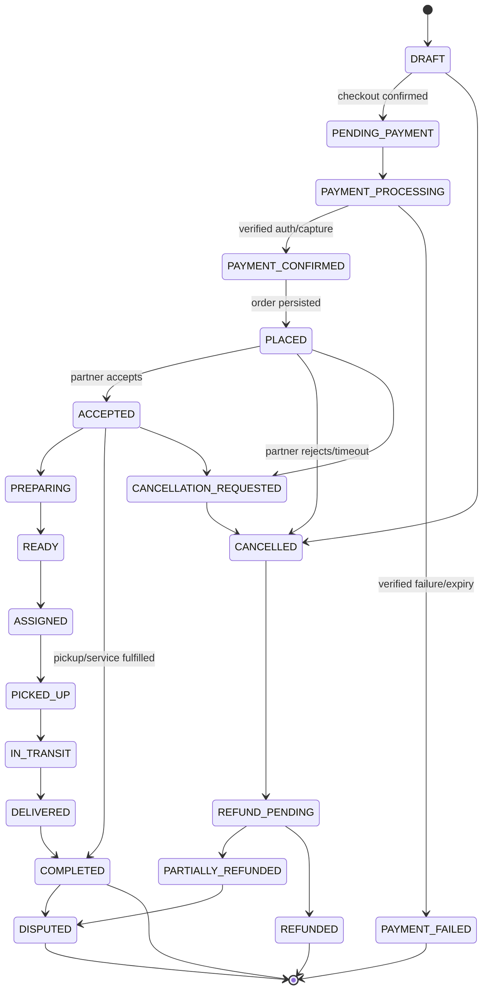

# 09 — Order Lifecycle

Order represents goods or a fulfillment request; bookings and money are separate linked entities. State transitions are server-side commands, permission-checked, version-checked and audited. Category profiles may skip irrelevant fulfillment states.

## Transition ownership and rules

| Transition | Actor / precondition | Timeout/recovery and visibility |
|---|---|---|
| DRAFT → PENDING_PAYMENT | Consumer confirms current quote; address/stock validated | Draft expires per configured duration; consumer sees draft/expiry |
| PENDING_PAYMENT → PAYMENT_PROCESSING | API creates idempotent payment attempt | Client timeout triggers lookup, never blind retry |
| PAYMENT_PROCESSING → PAYMENT_CONFIRMED/FAILED | Verified provider event/query only | Unknown stays processing; reconciliation queue; consumer sees “checking” |
| PAYMENT_CONFIRMED → PLACED | Atomic order record/link established | If persistence/submission fails, recovery case compensates payment; no orphan silent success |
| PLACED → ACCEPTED / CANCELLED | Authorized merchant accepts or rejects; deadline configured | Timeout triggers cancellation/reassignment per category; customer notified |
| ACCEPTED → PREPARING → READY | Merchant staff with order scope | Offline update is reconciled against version and current actor grant |
| READY → ASSIGNED → PICKED_UP → IN_TRANSIT | Dispatch/provider roles as applicable | States skipped only where fulfillment profile declares them inapplicable |
| IN_TRANSIT → DELIVERED → COMPLETED | Assigned provider and/or verified customer/system evidence per validated policy | Disputed completion creates case; no arbitrary client completion |
| Eligible active state → CANCELLATION_REQUESTED | Consumer, partner or platform initiates with reason | Policy determines immediate outcome or review; financial state remains separate |
| CANCELLATION_REQUESTED → CANCELLED | Policy decision/authorized operator | Refund/void initiated separately; status can be cancelled while refund pending |
| CANCELLED → REFUND_PENDING → PARTIALLY_REFUNDED/REFUNDED | Finance/payment service, verified provider | Failure remains pending/exception; immutable record and support queue |
| Completed/refunded states → DISPUTED | Consumer/authorized support within applicable policy | Preserve evidence; dispute does not rewrite completion or payment ledger |

`FAILED` is reserved for an order workflow that cannot be recovered; record failure reason and linked payment compensation. `ASSIGNED/PICKED_UP` can be omitted for pickup/non-dispatch service. No transitions are allowed merely because a client displays a button. Terminal state changes require compensating records, never mutation of history.

## Invalid transitions

Reject and audit: accept after rejection/timeout; prepare before acceptance; deliver before pickup for delivery profile; complete with unresolved required fulfillment; refund beyond captured balance; mutate cancelled order without explicit reopen policy. Include current version/state in conflict response so client can refresh.
