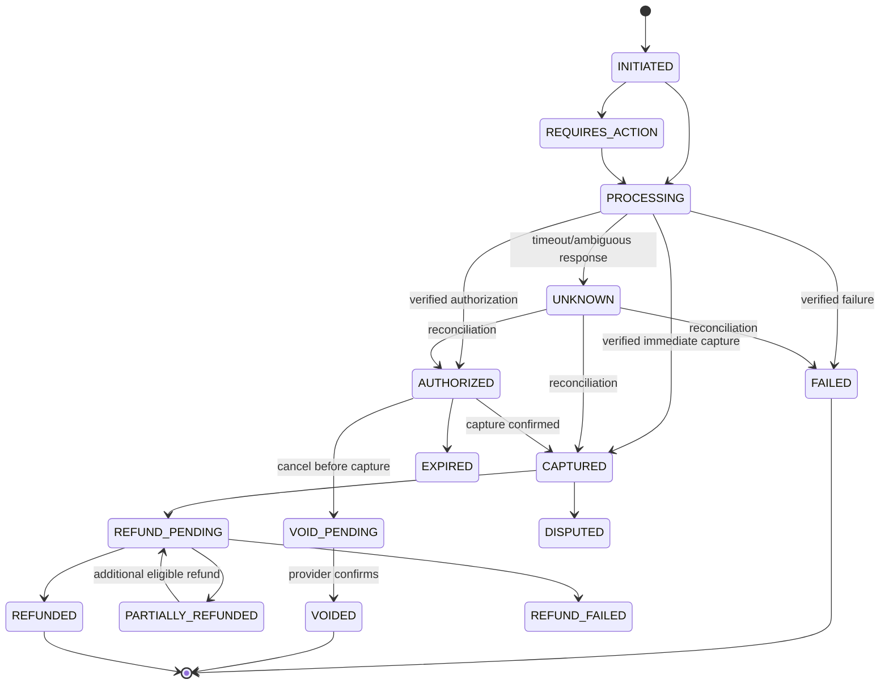

# 11 — Payment Lifecycle

KUNDE abstracts payment provider capabilities; no specific provider or authorization/capture model is assumed. Consumer-facing payment status reflects verified records, not a network request result.

## Functional contract

1. Create payment attempt with immutable amount, ISO currency, purpose, linked order/booking, payer, idempotency key and provider reference.
2. Authenticate customer with provider through provider-owned secure flow; KUNDE never stores raw card credentials unless future compliance approval explicitly changes scope.
3. Verify result via signed webhook and/or provider status query. Authenticate event, deduplicate event ID, validate amount/currency/reference, persist before acknowledging.
4. Treat delayed/ambiguous response as `UNKNOWN/PROCESSING`; query/reconcile before retrying payment or asking user for another instrument.
5. Capture only under the approved category policy and verified preconditions. Authorization is not capture; capture is not order fulfillment.
6. Refund/void is an idempotent command linked to original transaction and reason. Provider confirmation advances state; failed/pending operations remain visible and queued.
7. Immutable financial journal stores each attempt, authorization, capture, fee/commission, settlement, refund and dispute reference. Corrections are compensating entries; never edit/delete a posted entry.
8. Reconciliation compares platform and provider records on schedule and after exceptions; unmatched, duplicate, amount/currency-mismatched events are quarantined for finance review.
9. Settlement to partners is a separate lifecycle and only enabled after contract, KYC, tax and finance operations are approved. Commission formula and timing remain open decisions.

## Critical recovery: payment succeeded, order creation failed

Idempotency and correlation allow lookup. Record verified provider success first; retry order persistence using the same logical command. If order cannot be created or merchant submission fails, mark order workflow failed/cancelled, request void if uncaptured or refund if captured, notify user that compensation is pending, open operational exception and reconcile. Never tell user to retry payment until duplicate risk is resolved.

## Invariants

- Refund total ≤ captured amount − successful previous refunds.
- Same idempotency key and payload yields same logical attempt; payload mismatch rejects.
- Provider event replay cannot duplicate capture/refund/ledger entry.
- Order/booking state cannot imply payment paid unless verified state supports it.
- Currency/amount and merchant/payee context are checked at every boundary.
