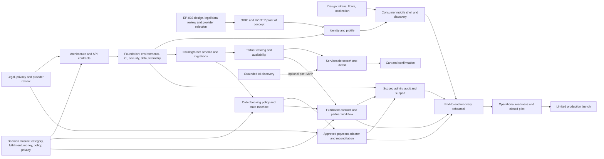

# 07 — Dependency Graph

## Critical path

1. Close D-01/D-02/D-03/D-04/D-06/D-07/D-08 and D-14 as relevant; establish legal, finance and operations owners.
2. Approve domain lifecycle, funds flow, contract/API and data/privacy boundaries.
3. Establish deployable environments; complete EP-002 provider/legal gates and OIDC/OTP proof; then implement identity/authorization, migration and audit/telemetry foundations.
4. Implement catalog/serviceability, partner work queue, order lifecycle and approved fulfillment/payment adapters.
5. Implement minimum consumer and admin/support surfaces against the same contracts.
6. Pass failure/recovery, reconciliation, security and operational rehearsal; then limited pilot gate.

## Parallel lanes and external prerequisites

Design foundations/localization, repo/CI baseline, decision closure and vendor procurement can progress in parallel. Backend and mobile foundations can progress in parallel once contracts/tokens are stable. Payment, OTP, maps/geocoding, messaging and hosting require vendor availability/cost/terms/residency checks; legal review gates production data and money. Provider app is conditional on fulfillment selection. Booking and AI are not on the pilot critical path unless the selected category requires them.

`dependencies.yaml` records prerequisite edges. They must remain acyclic. If a real-world prerequisite cannot be resolved, keep the dependent feature blocked rather than inventing a dependency workaround.

EP-002 design deliverables and gates are tracked in [25-identity-ep002-design.md](25-identity-ep002-design.md). `TASK-005` remains blocked; a proposed recommendation is not provider approval.

## GitHub-hosted verification migration — 2026-11-11

TASK-003 advances on standard free hosted runners through PR1, with independent
backend/Flutter/APK/security workflows and manual native E2E boundary. No paid,
personal Windows or self-hosted requirement. Remote-only discovery confirms
missing canonical identity/V2/abuse/Boot4 implementation; do not promote cloud
narrative into recovered source. TASK-006/046 in_progress; vulnerability findings
and native prerequisites remain open. [CI contract](../engineering-foundation/github-hosted-ci.md),
[security ledger](../security/ci-vulnerability-ledger.md).
